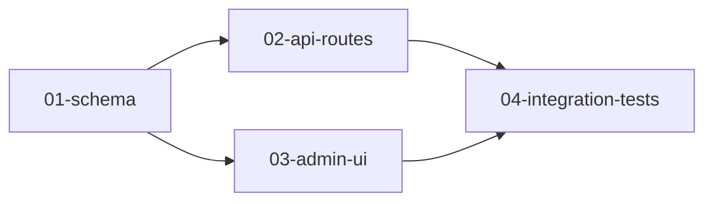

# Execution Plan Manifest Guide

## Dependency patterns

### Sequential chain

Plans run one after another. Each plan depends on the previous.

```text
01-schema → 02-middleware → 03-routes → 04-docs
```

```yaml
# 01-schema
depends_on: []

# 02-middleware
depends_on: ["01-schema"]

# 03-routes
depends_on: ["02-middleware"]
```

### Fan-out (parallel after shared foundation)

One plan unblocks multiple independent plans.

```text
        ┌→ 02-api-routes
01-schema ─┤
        └→ 03-admin-ui
```

```yaml
# 02-api-routes
depends_on: ["01-schema"]
parallel_group: "batch-a"

# 03-admin-ui
depends_on: ["01-schema"]
parallel_group: "batch-a"
```

Plans in `batch-a` may run concurrently once `01-schema` is complete.

### Fan-in (join after parallel work)

Multiple plans must complete before the next.

```text
02-api-routes ─┐
               ├→ 04-integration-tests
03-admin-ui ───┘
```

```yaml
# 04-integration-tests
depends_on: ["02-api-routes", "03-admin-ui"]
parallel_group: null
```

### Diamond

```text
        ┌→ 02-b ─┐
01-a ───┤       ├→ 04-d
        └→ 03-c ┘
```

```yaml
# 02-b
depends_on: ["01-a"]
parallel_group: "batch-1"

# 03-c
depends_on: ["01-a"]
parallel_group: "batch-1"

# 04-d
depends_on: ["02-b", "03-c"]
```

## Parallel group rules

1. Plans in the same `parallel_group` **must** have identical `depends_on` lists.
2. Plans with `parallel_group: null` run alone (one per batch when selected).
3. The drain CLI respects `--max-parallel` to cap concurrent agents.

## Phase README dependency graph (mermaid)



## Plan index table example

| id | file | depends_on | parallel_group | status |
| --- | --- | --- | --- | --- |
| 01-schema | 01-schema.md | [] | null | pending |
| 02-api-routes | 02-api-routes.md | [01-schema] | batch-a | pending |
| 03-admin-ui | 03-admin-ui.md | [01-schema] | batch-a | pending |
| 04-integration-tests | 04-integration-tests.md | [02-api-routes, 03-admin-ui] | null | pending |

Status values: `pending`, `in_progress`, `done` (removed from disk when done).

## Anti-patterns

- **Circular deps** — `01-a` depends on `02-b` depends on `01-a` (invalid)
- **Cross-phase deps** — plans in phase A depending on phase B (use separate phases + operator ordering instead)
- **Oversized plans** — one plan that spans multiple unrelated deliverables (split into smaller plans)
- **Missing validation** — plan with no acceptance criteria or validation commands
