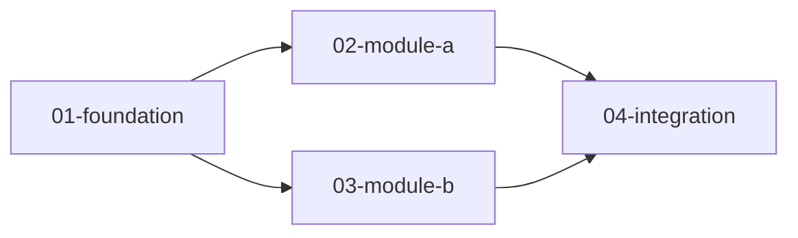

# Example Phase

Demonstration execution plan phase for dry-run testing of the drain CLI.

## Overview

This phase shows sequential and parallel plan patterns. Plans are documentation-only examples — they do not ship application code.

## Plan index

| id | file | depends_on | parallel_group | status |
| --- | --- | --- | --- | --- |
| 01-foundation | 01-foundation.md | [] | null | pending |
| 02-module-a | 02-module-a.md | [01-foundation] | batch-a | pending |
| 03-module-b | 03-module-b.md | [01-foundation] | batch-a | pending |
| 04-integration | 04-integration.md | [02-module-a, 03-module-b] | null | pending |

## Dependency graph



**Execution order:**

1. `01-foundation` (sequential)
2. `02-module-a` and `03-module-b` (parallel batch-a)
3. `04-integration` (sequential)

## Handoff prompt

```text
Execute ONLY this execution plan: docs/execution-plans/example-phase/NN-....md

Before changing code:
1. Read the plan file and phase README.
2. Implement only what the plan specifies.
3. Run project test/lint/typecheck when applicable.
4. Create one git commit: exec-plan(example-phase): <title>
5. Delete this plan file and update the phase README index.
6. Never put secrets in LLM context.
```
